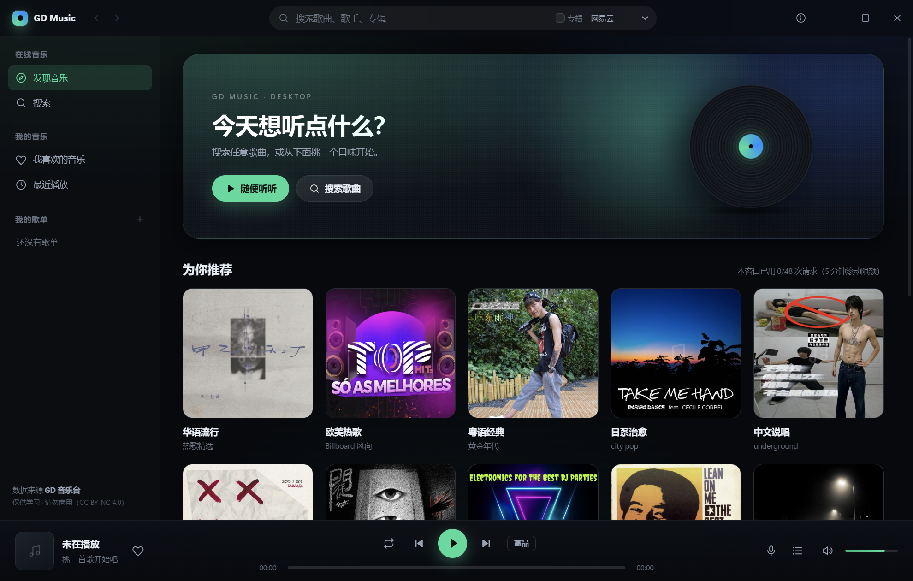
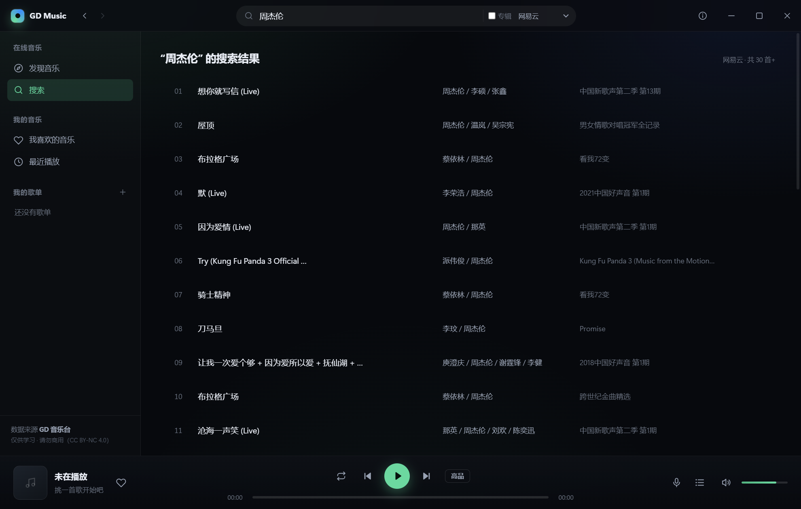
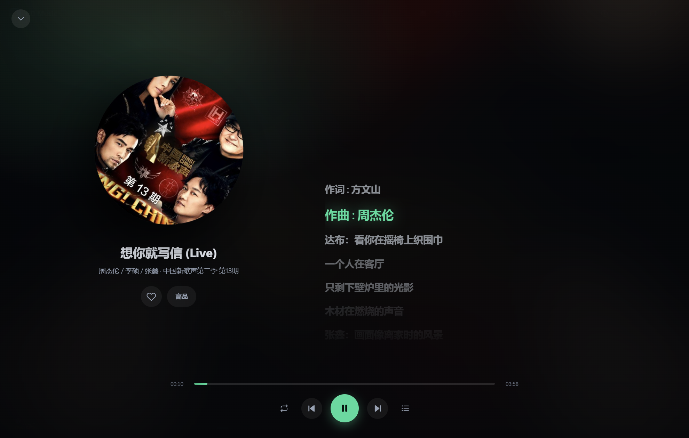

# GD-Music

一个用 **Electron + Vue 3** 写的桌面音乐播放器，界面与交互参考 QQ 音乐桌面端。
音乐数据和音源请求来自 [GD 音乐台](https://music.gdstudio.org/)。

> **仅供学习交流，请勿商用。** 音乐版权归各平台与原作者所有。收藏的音频会下载到当前用户的本地目录。

**使用帮助：[安装、歌单导入、下载、歌词、托盘与常见问题](docs/USER_GUIDE.md)** · 当前版本：**v1.0.8** · [审查与修复记录](docs/reviews/2026-10-23-v1.0.7-code-review.md)

## 下载安装

前往 [v1.0.8 发布页](https://github.com/kkkaqi/GD-Music/releases/tag/v1.0.8)，在 Assets 中选择：

- [Windows x64 安装版](https://github.com/kkkaqi/GD-Music/releases/download/v1.0.8/GD-Music-1.0.8-Windows-x64-Setup.exe)：双击安装，通过桌面或开始菜单启动。
- [Windows x64 免安装版](https://github.com/kkkaqi/GD-Music/releases/download/v1.0.8/GD-Music-1.0.8-Windows-x64-Portable.exe)：下载后双击运行。

两个版本均自带运行环境，无需安装 Node.js。发布页附有 `SHA256SUMS.txt`，用于核对下载文件。GitHub 自动生成的 Source code 压缩包是源码，不是安装包。



## 功能

- **搜索**：按歌曲 / 歌手 / 专辑搜索，支持分页加载与「专辑模式」（`types=search_album`）
- **音源与官网对齐**：网易云、QQ 音乐、酷我、TIDAL、Qobuz、JOOX、哔哩哔哩、Apple Music、YouTube Music、Embeat 共 10 个源，搜索、音频、封面、歌词统一沿用官网请求流程，不再按公开 API 的开放列表标记「未开放」。搜索按 20 条分页，JOOX 与官网一样不提供下一页；B站与 Embeat 不支持专辑模式。Embeat 仅在线播放，可收藏歌曲信息，跳过音频自动下载并在收藏页提示。
- **YouTube Music（油管）**：通过官网接口搜索、获取音频和封面，搜索按 20 条分页；支持播放、收藏自动下载和离线读取，下载保留实际 WebM/M4A 格式。歌词取决于音源返回。部分曲目可能无可用音频，使用现有错误提示及同曲换源流程。
- **播放**：HTML5 Audio 流式播放，上一首 / 下一首 / 进度拖拽 / 音量 / 静音
- **音质切换**：与官网一致，提供标准 128K / 较高 192K / 高品 320K / 16bit 无损 / 24bit 无损（保留播放进度与播放状态）。档位为请求目标，实际文件以音源返回为准。
- **音频下载**：手动下载和收藏自动保存均使用所选音质；支持 MP3、FLAC、M4A、WebM、OGG、WAV 及网页支持的 AAC、APE、AIFF、ALAC 格式。大文件流式写入，无固定 256MB 上限；连续两分钟无下载进度才超时，后台任务随后退避重试。Embeat 与网页一致仅支持在线播放。
- **播放模式**：列表循环 / 单曲循环 / 随机播放
- **歌词**：LRC 解析、逐行高亮、中英双语对齐、点击任意行跳转
- **播放页**：全屏唱片 + 歌词，带底部控制条
- **桌面歌词**：底部「词」按钮开关独立悬浮窗，当前句及其翻译使用所选高亮颜色（默认绿色），未播放的下一句及其翻译使用灰色；所有文字保持不透明，并使用清晰描边。支持播放控制、收藏、拖动、字体/颜色/背景透明度设置。窗口始终置顶，不跟随主窗口最小化；Windows 任务栏和 Alt+Tab 只显示主窗口。未打开设置时，鼠标移出歌词区域只显示歌词；移入后，未锁定显示面板和工具栏，锁定时只显示透明底小锁，歌词区域保持鼠标穿透。已打开的设置不会因移出窗口而关闭，原生调色板可在窗口外正常使用；再次点击设置、点击窗口内设置区域以外的位置或按 Esc 可关闭。锁定/解锁共用同一位置的按钮，也可在主窗口再次点击「词」解锁。位置与样式保存在本地。
- **歌词区域自适应**：桌面歌词设置中的「字体大小」提供 12、16、20、24、28、32、36、40px 预设，点击选择并自动保存；主设置面板固定在右侧，字号子菜单从左侧展开，展开或收起不会左右移动主面板；原文和翻译同步缩放，宽度随字号调整，高度根据实际文字及换行自动伸缩，并保持在屏幕可用范围内。
- **我的音乐**：我喜欢的音乐、最近播放（本地持久化）
- **收藏自动下载**：按当前音质下载支持下载的全部收藏，重启自动补下载；播放优先读取本地完整文件，支持离线播放和进度拖动。「我喜欢的音乐」显示下载进度、失败重试与音频文件夹入口。文件保存在用户数据目录的 `audio-cache` 中，按歌曲和音质区分；切换音质会补下载相应版本。取消收藏保留已有文件。Embeat 与官网一样仅在线播放，其收藏不加入下载队列。
- **歌单**：新建 / 重命名 / 删除 / 添加歌曲 / 导出为 txt
- **播放队列**：查看、跳播、移出、清空
- **发现页**：12 个精选口味卡片（懒加载封面）+ 最近在听
- **原生体验**：无边框窗口、自定义标题栏、媒体键（播放/暂停、上一首/下一首）和可拖动的进度条
- **窗口拖拽**：主窗口四边 10px、四角 16px 热区调整大小，其余空白处按住移动；按钮、输入框、歌曲列表、滚动条和进度条保持原有操作。最大化时拖动空白处会还原并移动，普通单击不会还原；桌面歌词交互不变。
- **系统托盘**：应用启动后显示 GD-Music 图标；右键菜单仅有“打开GD-Music”和“退出”。点击、双击图标或选择打开会显示主窗口并还原最小化状态；退出使用正常保存与窗口清理流程，并移除托盘图标。





## 快速开始

### 导入 GD 音乐台网页歌单配置

在网页设置中导出 `gdmusic_config_日期.json`，再在桌面端侧栏「我的歌单」旁点击导入按钮，选择该 JSON 文件。

- 网页收藏合并到「我喜欢的音乐」，按音源和歌曲 ID 去重。
- 网页播放历史、正在播放列表另存为本地歌单，不替换当前播放队列。
- 网页用户歌单优先读取配置内的曲目；仅含网易云歌单 ID 时联网补取，失败会显示歌单名称。
- 同名歌单追加编号，不覆盖已有歌单；再次导入会追加歌单。
- 兼容旧版桌面端单歌单 JSON。网页设置（音质、EQ、账户等）不随歌单导入。
- 桌面端导出仍是原有单歌单格式，目前不支持反向导入网页。

验证命令：`npm test`（导入、导出、播放及搜索回归测试）、`npm run test:electron`（构建并运行隔离的 Electron 界面与真实音频测试）、`npm audit --registry=https://registry.npmjs.org`。

### 启动

需要 Node.js 22.12 或更新版本。Electron 运行时在首次启动时下载并校验。

```bash
npm ci
npm start
```

`npm start` 会先 `vite build` 再启动 Electron。

| 命令 | 说明 |
| --- | --- |
| `npm start` | 构建渲染层并启动应用 |
| `npm run app` | 使用已有界面构建启动，首次使用前先运行 `npm run build` |
| `npm run dev` | 只启动 Vite 开发服务器（渲染层热更新，需另开 `npm run dev:electron`） |
| `npm run shot` | 使用已有界面构建启动截图模式，运行前先执行 `npm run build` |
| `npm run dist` | 生成 Windows x64 安装版与免安装版 EXE |

打包文件同时输出到项目 `release` 和桌面 `GD-Music-Release` 文件夹。安装版名称以 `Setup.exe` 结尾，免安装版以 `Portable.exe` 结尾，使用时均无需 Node.js。打包工具缓存和中间文件使用 `%LOCALAPPDATA%\GDMusic` 下的独立目录，避免旧缓存及中文构建路径导致原生工具启动失败。本机请从桌面英文目录 `GD-Music-Release` 使用交付文件。

## 技术栈

- **Electron 45**：主进程负责窗口、IPC、API 代理、限流与缓存
- **Vue 3 + Vite 8**：`<script setup>` 组合式 API，无 UI 框架，纯手写 CSS
- **自定义协议 `app://`**：打包后的页面用自定义 scheme 加载，避免 `file://` 下 ES module 被 CORS 拦截
- **contextIsolation + preload**：渲染进程无 Node 权限，所有能力经 `contextBridge` 暴露

## 目录结构

```
electron-music/
├─ scripts/launch.js        # 启动器（见「已知问题」）
├─ src/
│  ├─ main/
│  │  ├─ main.js            # 窗口、协议、IPC、媒体键
│  │  ├─ preload.js         # contextBridge 白名单
│  │  ├─ api.js             # GD API 客户端：5min/50 次限流 + 两级缓存
│  │  └─ store.js           # 原子写入的 JSON 状态存储
│  └─ renderer/
│     ├─ index.html
│     ├─ dist/              # 构建产物
│     └─ src/
│        ├─ App.vue         # 布局 + 快捷键
│        ├─ store.js        # 全局状态、导航、搜索、歌单
│        ├─ player.js       # 音频、队列、歌词同步
│        ├─ api.js          # IPC 封装
│        ├─ lrc.js          # LRC 解析
│        ├─ icons.js        # 内联 SVG 图标
│        ├─ ui.js           # Toast / Modal / 右键菜单
│        ├─ styles/main.css
│        └─ components/     # TitleBar / Sidebar / TrackList / PlayerBar ...
└─ assets/icon.png
```

## 接口说明

请求由**主进程**统一调度，渲染进程只通过 IPC 取数据。全部 10 个音源的搜索、音频地址、封面和歌词，使用隔离的无窗口网页页面复用官网请求流程，并经过共享限流器。页面没有 Node、preload 或本地 IPC 权限，阻断自动搜索及媒体加载，不产生额外任务栏窗口。专辑搜索使用官网的 `types=search_album`，保留曲目原始 ID 和独立的 `url_id`。

音频使用 Electron 的 Chromium 网络通道下载。播放和 HTTPS 音频下载携带当前官网 `https://music.gdstudio.org/` 来源；HTTP 下载不发送 HTTPS Referer，避免 Chromium 拒绝请求。下载使用完整 Range、核对文件长度，按实际 MP3/FLAC/M4A/WebM 等格式保存；手动下载复用完整缓存，不会额外请求已有文件。

音频地址只缓存成功结果；旧版本留下的空地址缓存会被忽略。下载遇到 HTTP 403/410 时清除目标 URL 的内存及磁盘缓存，刷新后重试一次；点击失败任务的“重试”也会重新解析。刷新请求仍合并并发解析并遵守共享限流，完整本地音频不重新下载。

| 接口 | 用途 | 缓存 |
| --- | --- | --- |
| `types=search` / `types=search_album` | 搜索曲目 / 拉取专辑曲目 | 6 小时 |
| `types=url` | 获取播放地址（`br` = 128/192/320/740/999） | 20 分钟 |
| `types=pic` | 专辑封面（300/500） | 7 天 |
| `types=lyric` | 歌词（原词 + 翻译） | 3 天 |

**限流**：所有 API 请求共享 5 分钟 48 次的滑动窗口，真实请求之间至少间隔 6.5 秒；后台下载在使用 36 次额度后等待，为播放和搜索保留额度。下载逐首进行，完成一次尝试后至少等待 8 秒。遇到 HTTP 429 等待至少 5 分钟，503 等临时服务错误按 30 秒至 5 分钟逐步延长等待并自动重试，遵守服务端 `Retry-After`。页面显示等待倒计时，临时错误不计为永久失败。请求记录和 API 冷却时间跨重启保存；相同请求合并，优先使用内存和磁盘缓存。发现页右侧显示当前窗口已用次数。

**已接入音源**：`netease`、`tencent`、`kuwo`、`tidal`、`qobuz`、`joox`、`bilibili`、`apple`、`ytmusic`、`embeat`。音源菜单表示已经接入，不保证所有曲目持续可用。Spotify 已不在官网当前菜单中，桌面端同步移除该菜单项；旧歌单保留歌曲数据，请求仍可发往官网，但当前实测官网返回 HTTP 400。

2026-10-22 核对记录见 [音源实测](docs/source-parity-2026-10-22.md)。QQ 抽测能搜索，但音频解析为空；Qobuz 两组关键词搜索为空。两者保留官网同样的请求入口，不视作永久不可用，也不承诺目前可播放。

## 快捷键

| 按键 | 功能 |
| --- | --- |
| `Space` | 播放 / 暂停 |
| `←` / `→` | 后退 / 前进 5 秒 |
| `↑` / `↓` | 音量 ±5% |
| `/` | 聚焦搜索框 |
| `Esc` | 关闭菜单 / 弹窗 / 播放页 / 队列 |

## 已知问题

### 中文路径下 Electron 会崩溃

本机（Windows 11 26200）实测：把 Electron 装在**包含中文的路径**下启动，会在初始化阶段直接崩溃（`0xc0000005`，事件日志里 faulting module 是 `electron.exe` 本身）。从纯 ASCII 路径启动则完全正常。

因为本项目位于 `...\Desktop\音乐\...`，所以加了 `scripts/launch.js`：

1. 首次运行时下载 Electron，并把 `node_modules/electron/dist` 复制到 `%LOCALAPPDATA%\GDMusic\runtime\<版本号>`（纯 ASCII 路径）
2. 用复制过去的 `electron.exe` 加载本项目
3. 每个版本独立保存，升级不会删除正在使用的旧运行时

若 npm 漏装 Windows 构建依赖，可运行 `npm install --include=optional` 后重试构建。测试使用临时用户数据目录、本地静音音频和模拟 API，不读写实际收藏，也不依赖在线音乐源可用性。

想跳过这层间接：把整个项目放到纯英文路径（如 `D:\code\gd-music`），然后直接 `electron .` 即可。

### 其它

- 部分曲目返回空地址，或音源暂不可用；不能据此断言歌曲在所有平台都不可用。
- 专辑图与原词来自第三方接口，个别曲目没有翻译歌词

v1.0.8 已修复失效链接重试、媒体加载失败换源、首次续播进度及搜索历史竞态。媒体错误会有限刷新同源地址，再按歌名和歌手匹配其他音源；暂停时恢复后仍暂停，全部失败才在有播放意图时跳歌。复现与修复记录见 [项目审查](docs/reviews/2026-10-23-v1.0.7-code-review.md)。

## 免责声明

本项目仅用于学习 Electron / Vue 3 技术，**严禁商用**。
音乐数据由 `music.gdstudio.xyz` 提供，版权归原作者及平台所有；如有侵权请联系删除。
使用该 API 请注明出处「GD音乐台（music.gdstudio.xyz）」。
